# DAG Action Graph

```mermaid
flowchart TD
    N0["press_key 'Tab' [/]<br/>step 1"]
    N1["press_key 'Tab' on Mute audio feedback [/]<br/>step 2"]
    N2["press_key 'Tab' on Re-Run All 6 Personas ... [/]<br/>step 4"]
    N3["press_key 'Tab' on Reset to Baseline (2/6) [/]<br/>step 5"]
    N4["press_key 'Tab' on MLMayaPASS [/]<br/>step 6"]
    N5["press_key 'Tab' on DPDevPASS [/]<br/>step 7"]
    N6["press_key 'Tab' on ASAnaPASS [/]<br/>step 8"]
    N7["press_key 'Tab' on SOSamPASS [/]<br/>step 9"]
    N8["press_key 'Tab' on LWLenaPASS [/]<br/>step 10"]
    N9["press_key 'Tab' on JMJoePASS [/]<br/>step 11"]
    N10["press_key 'Tab' on TAB SEQUENCE TRACEtabI... [/]<br/>step 13"]
    N11["press_key 'Tab' on VIEWPORT REFLOW · 200%... [/]<br/>step 14"]
    N12["press_key 'Tab' on 3G RTT WINDOW (450ms)1... [/]<br/>step 15"]
    N13["press_key 'Tab' on 375×667 MOBILE FRAMEAT... [/]<br/>step 17"]
    N14["press_key 'Tab' on LOCALE: de-DE (COMMA D... [/]<br/>step 18"]
    N15["press_key 'Tab' on SUBSCRIPTION PARITY2 C... [/]<br/>step 19"]
    N16["press_key 'Tab' on Re-Run Kane CLI Check [/]<br/>step 20"]
    N17["press_key 'Tab' on Standard Ground$10.00 [/]<br/>step 21"]
    N18["press_key 'Enter' on Express Air<button> TA... [/]<br/>step 23"]
    N19["analyze 'shipping_bad...' [/]<br/>step 24"]
    N0 --> N1
    N1 --> N2
    N2 --> N3
    N3 --> N4
    N4 --> N5
    N5 --> N6
    N6 --> N7
    N7 --> N8
    N8 --> N9
    N9 --> N10
    N10 --> N11
    N11 --> N12
    N12 --> N13
    N13 --> N14
    N14 --> N15
    N15 --> N16
    N16 --> N17
    N17 --> N18
    N18 --> N19
```

## Node Legend

| ID | Signature | First Seen |
|-----|-----------|------------|
| N0 | `http://localhost:4180/\|press_key\|Tab\|none` | step 1 |
| N1 | `http://localhost:4180/\|press_key\|Tab\|Mute audio feedback` | step 2 |
| N2 | `http://localhost:4180/\|press_key\|Tab\|Re-Run All 6 Personas (6/6 Verified)` | step 4 |
| N3 | `http://localhost:4180/\|press_key\|Tab\|Reset to Baseline (2/6)` | step 5 |
| N4 | `http://localhost:4180/\|press_key\|Tab\|MLMayaPASS` | step 6 |
| N5 | `http://localhost:4180/\|press_key\|Tab\|DPDevPASS` | step 7 |
| N6 | `http://localhost:4180/\|press_key\|Tab\|ASAnaPASS` | step 8 |
| N7 | `http://localhost:4180/\|press_key\|Tab\|SOSamPASS` | step 9 |
| N8 | `http://localhost:4180/\|press_key\|Tab\|LWLenaPASS` | step 10 |
| N9 | `http://localhost:4180/\|press_key\|Tab\|JMJoePASS` | step 11 |
| N10 | `http://localhost:4180/\|press_key\|Tab\|TAB SEQUENCE TRACEtabIndex=0 · <button>1. Standard ($10)2. Express ($18) [TAB OK]MLMaya Lin34, Seatt` | step 13 |
| N11 | `http://localhost:4180/\|press_key\|Tab\|VIEWPORT REFLOW · 200% SCALE0px OccludedComplete Order ($148.00)DPDev Patel49, Austin, TX PASS200% B` | step 14 |
| N12 | `http://localhost:4180/\|press_key\|Tab\|3G RTT WINDOW (450ms)1x Billed ($148.00)Click #1 (0ms)Click #2 LockedASAna Silva28, São Paulo, BR PA` | step 15 |
| N13 | `http://localhost:4180/\|press_key\|Tab\|375×667 MOBILE FRAMEATELIER20 (-$20)Promo: ATELIER20$148 → $128.00SOSam Okafor25, Lagos, NG PASS375×` | step 17 |
| N14 | `http://localhost:4180/\|press_key\|Tab\|LOCALE: de-DE (COMMA DECIMAL)Integer Cents OK118,40 € + 17,76 € =136,16 €LWLena Weber39, Berlin, DE ` | step 18 |
| N15 | `http://localhost:4180/\|press_key\|Tab\|SUBSCRIPTION PARITY2 Clicks · HTTP 200Join: 2 ClicksCancel: 2 Clicks ✓JMJoe Miller41, Chicago, IL PA` | step 19 |
| N16 | `http://localhost:4180/\|press_key\|Tab\|Re-Run Kane CLI Check` | step 20 |
| N17 | `http://localhost:4180/\|press_key\|Tab\|Standard Ground$10.00` | step 21 |
| N18 | `http://localhost:4180/\|press_key\|Enter\|Express Air<button> TAB OK$18.00` | step 23 |
| N19 | `http://localhost:4180/\|analyze\|shipping_badge_express_air\|none` | step 24 |
