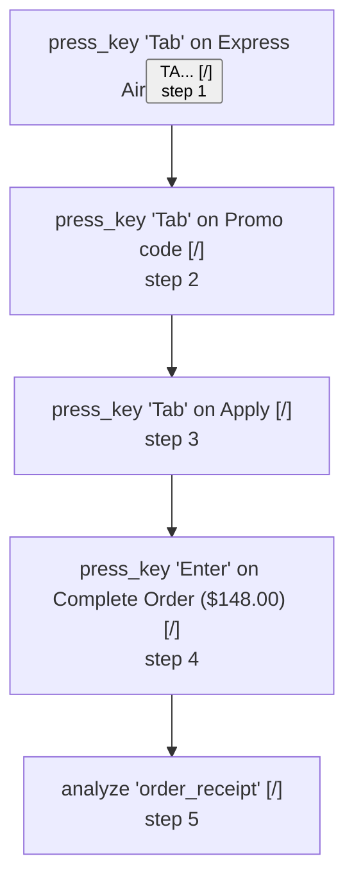

# DAG Action Graph

## Node Legend

| ID | Signature | First Seen |
|-----|-----------|------------|
| N0 | `http://localhost:4180/\|press_key\|Tab\|Express Air<button> TAB OK$18.00` | step 1 |
| N1 | `http://localhost:4180/\|press_key\|Tab\|Promo code` | step 2 |
| N2 | `http://localhost:4180/\|press_key\|Tab\|Apply` | step 3 |
| N3 | `http://localhost:4180/\|press_key\|Enter\|Complete Order ($148.00)` | step 4 |
| N4 | `http://localhost:4180/\|analyze\|order_receipt\|none` | step 5 |
