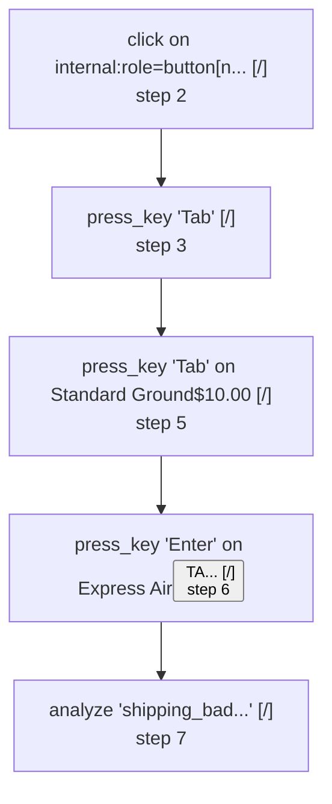

# DAG Action Graph

## Node Legend

| ID | Signature | First Seen |
|-----|-----------|------------|
| N0 | `http://localhost:4180/\|click\|\|internal:role=button[name="Auto-Heal Defect & Re-Verify"i]` | step 2 |
| N1 | `http://localhost:4180/\|press_key\|Tab\|none` | step 3 |
| N2 | `http://localhost:4180/\|press_key\|Tab\|Standard Ground$10.00` | step 5 |
| N3 | `http://localhost:4180/\|press_key\|Enter\|Express Air<button> TAB OK$18.00` | step 6 |
| N4 | `http://localhost:4180/\|analyze\|shipping_badge_express_air\|none` | step 7 |
